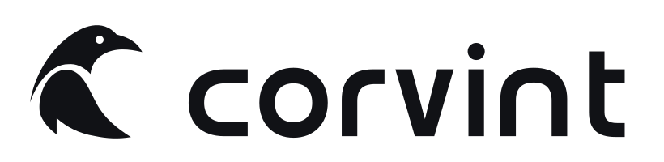

<p align="center">
  <picture>
    <source media="(prefers-color-scheme: dark)" srcset="assets/brand/corvint-lockup-dark.svg">
    
  </picture>
</p>

<h1 align="center">Corvint</h1>

<p align="center">A <a href="https://github.com/beamfall">Beamfall</a> project.</p>

<p align="center">Git-pinned evidence for coding agents: what a change reaches, which tests it needs, and what each hunk rests on.</p>

<p align="center">
  <a href="#try-it-in-sixty-seconds">Quickstart</a> ·
  <a href="#what-corvint-can-do">Capabilities</a> ·
  <a href="#mcp-servers-and-agent-adapters">Agents</a> ·
  <a href="#what-has-been-measured">Measured results</a> ·
  <a href="docs/README.md">Documentation</a>
</p>

<p align="center">
  
  
  
  
  
</p>

## What Corvint does for a coding agent

An agent that edits a repository has to answer the same questions every time: what does this
change reach, which tests must run, and can a reviewer check what the change rests on? Corvint
answers them from the repository itself, with evidence pinned to Git content, and says so when it
cannot.

- **Proof-carrying, Git-pinned context.** Every result from `impact`, `context` and `affected`
  names the Git blob it came from, the authority that admitted it and the reason it was
  included. Coverage, omissions and uncertainty are part of the receipt. Missing evidence is
  reported as unknown, never filled in, and the project's own instructions, decisions and specs
  outrank syntax matches and history.
- **Impact analysis and affected-test selection.** `corvint impact` reports what a path or a
  committed range reaches. `corvint affected` maps a change to the test units it can reach across
  Go, JavaScript/TypeScript, Python, Ruby, Rust, Swift, Kotlin and .NET, plus the checks the
  project declares mandatory. When it cannot prove a narrower set (an unresolved import, an
  untracked file, a dynamic configuration) it names the reason and widens instead of skipping.
- **Agent integration.** Stdio MCP servers expose the same receipts to any MCP host, and adapters
  for Codex, Claude Code, Gemini CLI, OpenCode and Pi feed one bounded lifecycle event to Corvint.
- **One local release.** `corvint` is a single native Go binary today; decision 0591 accepts a
  native Go core plus manifest-named bundled apps as the direction, not yet shipped. Either way it
  has no account, network call, hosted service, database,
  embeddings or permanent daemon. The root `go.mod` declares no external module requirements. Read commands report `mutates: false`; the only exceptions are two bounded private
  ledgers under `.corvint/`, one of them only while an operator marker exists
  ([AGENTS.md](AGENTS.md) invariant 4).

Corvint does not claim to make an agent cheaper or faster. Paired agent trials found no
measurable cost or success effect from injecting context up front
([measured results](#what-has-been-measured)); the value is in the checks.

## What Corvint can do

**core** means a Core verb from `corvint help` (only the modes the
[Core compatibility freeze](docs/specs/core-compatibility-freeze-v1.md) lists are frozen);
**experimental** means it works today with no stability promise. The full catalog of every
command, binary and MCP tool, with when to use each one and how it refuses, is
[docs/CAPABILITIES.md](docs/CAPABILITIES.md). A Go test keeps that catalog and this table in step
with the code.

<!-- capability-gate:readme -->
| Capability | What you get | Try it | Maturity |
|---|---|---|---|
| Affected test selection | The tests to run for a branch, the mandatory checks, and an explicit unknown frontier instead of a silent full run | `corvint affected --base FULL_SHA` | core |
| Impact of a change | What a path or a committed range reaches, with uncertainty where a rule is missing | `corvint impact internal/date/parse.go` | core |
| Application map | A checked map of a web application that E2E-safe test selection reads | `corvint flows appmap build --manifest appmap.json --revision HEAD` | experimental |
| Documentation corpus | Source-pinned documentation you can build, search and serve to agents | `corvint docs corpus search --artifact corpus.json --query login` | experimental |
| Application flows | Flows, assertions, coverage and gaps for a web application | `corvint flows --manifest flows.json` | experimental |
| Language support | Impact rules for Go, Ruby, JavaScript and TypeScript; affected-test providers for eleven ecosystems from Go to Swift and .NET; everything else is reported as unknown | `corvint affected --base FULL_SHA --full` | core verb; individual language providers are experimental |
| Path brief | The instructions, tests and requirements linked to a file or directory, each section with its state; nothing is ranked | `corvint context --path internal/date/parse.go` | core verb; the path brief is experimental |
<!-- /capability-gate:readme -->

## Try it in sixty seconds

You need Git and Go 1.27.4 or later on macOS or Linux. Build the binary from a checkout:

```console
git clone https://github.com/beamfall/corvint.git
cd corvint
mkdir -p "$HOME/.local/bin"
GOTOOLCHAIN=local go build -o "$HOME/.local/bin/corvint" ./cmd/corvint
export PATH="$HOME/.local/bin:$PATH"
corvint --version
```

Ask what a change to the CLI entry point reaches:

```console
corvint impact cmd/corvint/main.go --limit 3
```

The JSON receipt lists each result under `context.results` with its evidence: the path, the Git
`blob_hash`, the `authority` and `confidence`, and the `reason` it was admitted (for example
`same-package test for cmd/corvint/main.go`). `context.coverage` says how many results the limit
left out, and `"mutates": false` confirms the call wrote nothing. The first call on a tree builds
the index in memory and prints a hint on stderr to run `corvint index --if-stale` once per
committed tree.

Edit any Go file, then plan the tests for the dirty worktree:

```console
corvint affected
```

`summary.line` gives the scope and the selected, excluded and unknown counts with a reason for
each unknown; `plan` lists the units and `advice` the checks the repository declares. In your own
repository, put the root before the verb and plan a committed range:
`corvint --root /path/to/repo affected --base FULL_BASE_SHA`.

`corvint help` lists every verb, `corvint COMMAND --help` prints a command's contract, and
`corvint help guide` maps common agent goals to runnable command sequences. The
[installation guide](docs/INSTALL.md) covers release archives, checksum verification, optional
tools, upgrades and removal.

## The workflow

| When | Ask Corvint to | What you get back |
|---|---|---|
| Before editing | Show what governs and what a path reaches (`impact`, `context`) | Pinned results with authority, reasons, coverage and uncertainty |
| Before running tests | Plan the tests a change can reach (`affected`) | Selected test units, mandatory checks, and a named reason whenever the plan widens |
| After the run | Record what actually ran (test providers, `flows ingest`) | A receipt pinned to the run, its environment and the source commit |

A green test run is a fact about that run; Corvint never treats it as proof that the tests are
adequate.

## Corvint Tasks

The local ticket store and roadmap, `corvint-tasks`, is a separate project:
[beamfall/corvint-tasks](https://github.com/beamfall/corvint-tasks) (decision 0594). Corvint works without it.

## Agent plugins

Each MCP server is a local stdio process bound to one repository root and is read-only
([protocol and setup](docs/MCP-SERVER.md)):

| Server | Tools |
|---|---|
| `corvint-mcp` | `corvint.impact`, `corvint.status` and `corvint.help` |
| `corvint-docs-mcp` | `corvint.docs_draft` drafts source-pinned documentation; `corvint.docs_consume` rechecks a draft against source |
| `corvint-test-validity-mcp` | Discovery and projection of retained test evidence |

`corvint mcp ARGS` serves the `corvint-mcp` server from the core binary (AHI-373); build the others with `GOTOOLCHAIN=local go build -o "$HOME/.local/bin/NAME" ./cmd/NAME`.

The [Claude Code](integrations/claude-code/README.md) and [Codex](integrations/codex/README.md)
plugins run `corvint` from `PATH` and drive kept reads such as `affected`, `impact`, `index` and `review`.
The editor server and the lifecycle host adapters were removed by decision 0594.

Other tools in this repository (test providers, analyzers and release checks) are listed with their maturity in the
[capability catalog](docs/CAPABILITIES.md). They are qualified separately and carry no Core
stability promise.

## What has been measured

These are the retained results. Each is linked to its evidence; older evidence lives in the
[`beamfall/corvint-history`](https://github.com/beamfall/corvint-history) archive.

| Question | Result |
|---|---|
| Does test selection catch real failures? | On 30 real CI test failures in Corvint's own pull requests, `affected`-style selection caught 30 of 30 (Wilson 95% lower bound 0.89); import-graph selectors without Corvint's rules caught 19 to 22. The selected packages were an estimated median 87% of full-suite cost, so the claim is safety, not speed. Measured on Corvint only ([evidence](https://github.com/beamfall/corvint-history/blob/1c4d8793cf71cbb01b8509b68a6cb1502a40a13e/docs/build-log/2026-10-27-value-audit-verification-over-injection.md)). |
| Does injecting context help an agent? | No measurable effect. Haiku 5.5, 10 pairs: geometric cost ratio 0.997 (95% CI 0.85 to 1.20). Sonnet 5.5, 20 pairs: 0.987 (0.89 to 1.10), 20 of 20 resolved in both arms. Agents found the files they edited within one or two steps without help ([evidence](https://github.com/beamfall/corvint-history/blob/1c4d8793cf71cbb01b8509b68a6cb1502a40a13e/docs/build-log/2026-10-27-value-audit-verification-over-injection.md)). |
| Does task orientation find the critical files? | Not yet. In the rc.2 evaluation, orientation missed critical files that a lexical baseline found on all three repositories; change consequence and evidence-carrying completion passed ([release notes](docs/RELEASE-NOTES.md#100-rc2-release-candidate)). |
| Is broad retrieval reliable? | No. A held-out attempt beat exact search on top-5 (0.571 against 0.343) but returned forbidden results on 7 of 36 must-exclude checks ([decision 0307](docs/decisions/0307-alpha-release-bar-blind-v6-attempted-fail-2026-09-17.md)). On ContextBench (1,132 rows), `corvint query` had file recall 0.245 against 0.318 to 0.375 for grep and BM25, and `corvint context` had 0.483 ([evidence](https://github.com/beamfall/corvint-history/blob/1c4d8793cf71cbb01b8509b68a6cb1502a40a13e/docs/build-log/2026-10-25-v0415-contextbench-swebench-pro.md)). Rely on named paths and subjects, not ranking. |
| Does hunk reversal show causal support? | No. Of 3,790 eligible Go hunks, none was held; the opt-in `--hunk-revert` step ships with recorded limits ([evidence](https://github.com/beamfall/corvint-history/blob/1c4d8793cf71cbb01b8509b68a6cb1502a40a13e/docs/build-log/2026-10-20-V1-1266-hunk-revert-falsifier.md)). |

The 1.0 stability promise (frozen contracts, N-1 readers or deterministic migrations) covers the
Core surfaces in the [1.0 scope](docs/specs/corvint-1.0-product-and-release-v1.md) and nothing
else. Release archives are unsigned: `SHA256SUMS` only, publisher identity `NOT_VERIFIED`
([decision 0433](docs/decisions/0433-rc2-stable-signing-and-support-policy-2026-09-29.md)). Each
release's assets and per-platform qualification are on the
[releases page](https://github.com/beamfall/corvint/releases) and in the
[release notes](docs/RELEASE-NOTES.md); a source build qualifies nothing by itself.

## Read next

- [Documentation and repository layout](docs/README.md)
- [Capability catalog](docs/CAPABILITIES.md): every command, binary and MCP tool
- [Product contract](docs/PRODUCT.md) and [architecture](docs/ARCHITECTURE.md)
- [Agent evidence routes](docs/AGENT-ROUTES.md): task-sized paths to authority, code and tests
- [Specification index](docs/specs/README.md): accepted intent and delivery state

## Development

Corvint is built with Corvint. Read [CONTRIBUTING.md](CONTRIBUTING.md) and the
[agent contract](AGENTS.md) before a change. For a scoped change, run
`corvint affected --base FULL_BASE_SHA`, keep its unknowns, then run the focused tests and the
checks the owning spec requires. Repository-wide validation uses the exhaustive gate:

```console
test "$(GOTOOLCHAIN=local go env GOVERSION)" = "go1.27.4"
GOTOOLCHAIN=local make gate
```

The gate pins exactly `go1.27.4`. If your `go` reports another patch version, install the pinned
toolchain alongside it and put its `bin` directory first on `PATH` for gate commands only. Core
builds and the native regression suite do not need Python; adapter tests use their hosts' Node
runtime ([native regression ownership](tests/README.md)).

## License

Corvint is licensed under the Apache License 2.0 across the whole repository. See
[LICENSE](LICENSE) for the text, [LICENSING.md](LICENSING.md) for notes on earlier releases and
third-party notices, and [PROVENANCE.md](PROVENANCE.md).
